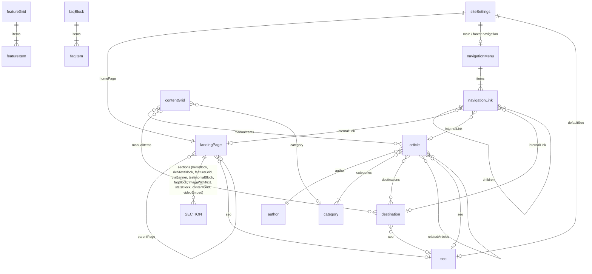

# Content model

The Contentful content model of the Driftwood Travel website. It is defined in code in
[`contentful/migrations/`](../contentful/migrations) (applied with `npm run cf:migrate`), and a full
snapshot of the model and all content lives in [`contentful/export/space.json`](../contentful/export/space.json).

- **Space:** one environment (`master`), 23 content types (22 used by the site + `migrationLog`)
- **Locales:** `en-US` (default) and `nl-NL` (optional, falls back to `en-US`)
- **Content tags:** `sponsored`, `campaignSummer2026`, `evergreen` (public), `needsReview` (private)

## Overview

Rich text fields (`article.body`, `destination.description`, `richTextBlock.body`, `faqItem.answer`,
`imageWithText.body`) also reference other entries: embedded `videoEmbed` / `ctaBanner` blocks,
embedded assets, and inline hyperlinks to `landingPage`, `article` and `destination` entries.

## How the website uses the model

| Concept | Where it lives |
|---|---|
| Page URLs | `landingPage` URLs are not stored: they are built from `slug` + the `parentPage` chain (`about` → `team` = `/about/team`). The landing page with slug `home` is `/`. Articles live at `/blog/{slug}`, destinations at `/destinations/{slug}`, authors at `/authors/{slug}`, categories at `/blog/category/{slug}`. Every URL is prefixed with the language: `/en/…`, `/nl/…`. |
| Slugs | Not localized: the Dutch page has the same slug as the English page. |
| Shared blocks | Blocks are standalone entries and are reused across pages, e.g. `cta:newsletter` appears on four pages and several `faqItem`s are referenced by more than one `faqBlock`. |
| Query-driven sections | `contentGrid.mode` = `latestArticles`, `featuredDestinations` or `category` is filled by a query at render time; only `manual` uses `manualItems`. |
| Navigation | `navigationLink` points to an entry (`internalLink`) or to a `url`. Site paths in `url` (e.g. `/blog`) are code routes and get the language prefix. Footer items without a link act as column headings. |
| Redirects | `redirect` entries are read at build time (`next.config.ts`) and applied to both language prefixes. |
| SEO | `seo` entries are referenced by pages; `siteSettings.defaultSeo` is the fallback. |
| JSON fields | `statsBlock.stats` and `destination.highlights` are localized JSON arrays; `author.socialLinks` and `siteSettings.socialLinks` are plain objects. |
| Markdown | `author.bio` and `destination.travelTips` are long text fields edited with the markdown editor. |
| Enums | `destination.region`, `ctaBanner.theme`, `heroBlock.variant`, icons etc. are validated `Symbol` values; region labels are translated in code (`src/lib/i18n.ts`). |
| Location | `destination.location` is a Location field (`{ lat, lon }`) shown as a map. |
| Content tags | `sponsored` shows a badge on article cards; the other tags are editorial metadata. |
| Draft mode | `/api/draft` switches all queries to the Content Preview API. |

## Content inventory

| Content type | Entries | Notes |
|---|---|---|
| `landingPage` | 20 | 1 home + 19 pages, nested two levels (`/about/*`, `/services/*`) |
| `article` | 55 published + 3 draft + 1 archived | |
| `destination` | 25 | real places and coordinates, fictional prices |
| `author` | 8 | |
| `category` | 10 | |
| `seo` | 94 | not every page has one |
| Blocks | 123 | hero 17, rich text 16, feature grid 7 (+24 items), CTA 7, testimonial 6, FAQ 5 (+16 items), image with text 7, stats 3, content grid 5, video 4 |
| `navigationMenu` / `navigationLink` | 2 / 39 | main menu (two levels) and footer |
| `siteSettings` | 1 | singleton |
| `redirect` | 11 | incl. one external and two non-permanent |
| Assets | 73 | 58 photos, 14 portraits, 1 SVG logo |

**100 routable published pages:** 20 landing pages + 55 articles + 25 destinations, each in English and Dutch.

### Translation coverage

About 80 % of the content is translated to Dutch. The rest is English-only and falls back to English on `/nl/…`:

- landing pages `corporate-travel`, `press`, `terms-and-conditions` (and their blocks)
- every fifth article (11 articles)
- destinations `wadi-rum`, `hanoi`, `cusco`, `queenstown`
- asset titles/descriptions for portraits and the logo

### Editorial states and edge cases

| Entry | State |
|---|---|
| Article "Winter in Lisbon…" | Draft, with a **scheduled publish** on 2027-01-15 09:00 Europe/Amsterdam |
| Article "Chasing the northern lights…" | Draft with missing required fields (`heroImage`, `body`, `author`); tagged `needsReview` |
| Article "The only packing list you'll ever need" | Draft, English only |
| Article "Flash sale: 25% off city breaks this summer" | Archived |
| Article `a-first-timers-guide-to-hanoi` | Published; the unpublished draft adds "(2027 update)" to the title |
| Destination `porto` | Published; the unpublished draft adds a sentence to `summary` |
| Article `where-to-eat-in-swiss-alps-a-locals-guide` | Its `seo` entry has `noIndex: true` |
| Every tenth article | Has no `seo` entry (falls back to page fields and the default SEO) |
| Landing page `newsletter` | `showInSitemap: false` and `noIndex: true` |
| Page `corporate-travel` | tagged `needsReview` (private tag) |

## Content types

Generated from `contentful/export/space.json`. "Loc." = localized, "Req." = required.

### `landingPage` — Landing page

Flexible page built from sections. The URL is built from the parent chain, e.g. about > team = /about/team. The page with slug 'home' is the homepage.

| Field | Type | Req. | Loc. | Validations | Editor |
|---|---|---|---|---|---|
| `title` | Symbol | ✓ | ✓ |  |  |
| `slug` | Symbol | ✓ |  | unique; regex | slugEditor |
| `parentPage` | Entry → landingPage |  |  |  | entryLinkEditor |
| `sections` | Entry[] → heroBlock \| richTextBlock \| featureGrid \| ctaBanner \| testimonialBlock \| faqBlock \| imageWithText \| statsBlock \| contentGrid \| videoEmbed |  |  | size 0–12 | entryCardsEditor |
| `seo` | Entry → seo |  |  |  |  |
| `showInSitemap` | Boolean |  |  |  |  |

### `article` — Blog article

Travel blog post, published at /blog/{slug}.

| Field | Type | Req. | Loc. | Validations | Editor |
|---|---|---|---|---|---|
| `title` | Symbol | ✓ | ✓ |  |  |
| `slug` | Symbol | ✓ |  | unique; regex | slugEditor |
| `excerpt` | Text |  | ✓ | size 0–300 | multipleLine |
| `heroImage` | Asset | ✓ |  | images only |  |
| `body` | RichText | ✓ | ✓ | rich text: limited nodes |  |
| `author` | Entry → author | ✓ |  |  |  |
| `categories` | Entry[] → category |  |  | size 1–3 |  |
| `destinations` | Entry[] → destination |  |  | size 0–3 |  |
| `tags` | Symbol[] |  |  |  | tagEditor |
| `publishDate` | Date | ✓ |  |  | datePicker |
| `readingTimeMinutes` | Integer |  |  | range 1–60 | numberEditor |
| `featured` | Boolean |  |  |  |  |
| `relatedArticles` | Entry[] → article |  |  | size 0–3 |  |
| `seo` | Entry → seo |  |  |  |  |

### `destination` — Destination

Bookable destination, published at /destinations/{slug}.

| Field | Type | Req. | Loc. | Validations | Editor |
|---|---|---|---|---|---|
| `name` | Symbol | ✓ | ✓ |  |  |
| `slug` | Symbol | ✓ |  | unique; regex | slugEditor |
| `tagline` | Symbol |  | ✓ |  |  |
| `summary` | Text |  | ✓ |  |  |
| `heroImage` | Asset | ✓ |  | images only |  |
| `gallery` | Asset[] |  |  | size 0–8; images only | assetGalleryEditor |
| `country` | Symbol | ✓ | ✓ |  |  |
| `region` | Symbol | ✓ |  | one of: Europe, Asia, Africa, North America, South America, Oceania, Middle East | dropdown |
| `location` | Location | ✓ |  |  |  |
| `priceFrom` | Number |  |  | range 0– |  |
| `currency` | Symbol |  |  | one of: EUR, USD, GBP | radio |
| `tripLengthDays` | Integer |  |  | range 1–60 |  |
| `bestMonths` | Symbol[] |  |  | one of: jan, feb, mar, apr, may, jun, jul, aug, sep, oct, nov, dec | checkbox |
| `rating` | Number |  |  | range 1–5 |  |
| `highlights` | Object |  | ✓ |  | objectEditor |
| `travelTips` | Text |  | ✓ |  | markdown |
| `description` | RichText |  | ✓ | rich text: limited nodes |  |
| `featured` | Boolean |  |  |  |  |
| `seo` | Entry → seo |  |  |  |  |

### `author` — Author

Writer of blog articles. Has a public profile page at /authors/{slug}.

| Field | Type | Req. | Loc. | Validations | Editor |
|---|---|---|---|---|---|
| `name` | Symbol | ✓ |  |  |  |
| `slug` | Symbol | ✓ |  | unique; regex | slugEditor |
| `role` | Symbol |  | ✓ |  |  |
| `bio` | Text |  | ✓ |  | markdown |
| `avatar` | Asset |  |  | images only |  |
| `email` | Symbol |  |  | regex |  |
| `socialLinks` | Object |  |  |  | objectEditor |
| `isStaff` | Boolean |  |  |  | boolean |

### `category` — Category

Blog category. Articles reference 1-3 categories.

| Field | Type | Req. | Loc. | Validations | Editor |
|---|---|---|---|---|---|
| `name` | Symbol | ✓ | ✓ |  |  |
| `slug` | Symbol | ✓ |  | unique; regex | slugEditor |
| `description` | Text |  | ✓ |  |  |
| `color` | Symbol |  |  | regex |  |
| `icon` | Symbol |  |  | one of: compass, mountain, utensils, camera, sun, snowflake, train, wallet, leaf, users, shield, heart, map, plane, star | dropdown |

### `seo` — SEO metadata

Reusable SEO settings. Referenced from pages and from Site settings (default).

| Field | Type | Req. | Loc. | Validations | Editor |
|---|---|---|---|---|---|
| `internalName` | Symbol | ✓ |  |  |  |
| `metaTitle` | Symbol |  | ✓ | size 0–70 |  |
| `metaDescription` | Text |  | ✓ | size 0–170 | multipleLine |
| `ogImage` | Asset |  |  | images only |  |
| `noIndex` | Boolean |  |  |  |  |
| `noFollow` | Boolean |  |  |  |  |
| `canonicalUrl` | Symbol |  |  | regex |  |

### `siteSettings` — Site settings

Global settings. Exactly one entry of this type should exist.

| Field | Type | Req. | Loc. | Validations | Editor |
|---|---|---|---|---|---|
| `internalName` | Symbol | ✓ |  |  |  |
| `siteName` | Symbol | ✓ | ✓ |  |  |
| `logo` | Asset |  |  | images only |  |
| `homePage` | Entry → landingPage | ✓ |  |  |  |
| `mainNavigation` | Entry → navigationMenu |  |  |  |  |
| `footerNavigation` | Entry → navigationMenu |  |  |  |  |
| `footerText` | Text |  | ✓ |  |  |
| `announcement` | Symbol |  | ✓ |  |  |
| `defaultSeo` | Entry → seo |  |  |  |  |
| `socialLinks` | Object |  |  |  |  |

### `navigationMenu` — Navigation menu

Ordered list of navigation links (main menu, footer).

| Field | Type | Req. | Loc. | Validations | Editor |
|---|---|---|---|---|---|
| `internalName` | Symbol | ✓ |  |  |  |
| `items` | Entry[] → navigationLink |  |  |  |  |

### `navigationLink` — Navigation link

Menu item. Links to a page entry, or to a custom URL for code routes like /blog.

| Field | Type | Req. | Loc. | Validations | Editor |
|---|---|---|---|---|---|
| `label` | Symbol | ✓ | ✓ |  |  |
| `internalLink` | Entry → landingPage \| article \| destination |  |  |  |  |
| `url` | Symbol |  |  | regex | urlEditor |
| `openInNewTab` | Boolean |  |  |  |  |
| `children` | Entry[] → navigationLink |  |  | size 0–8 |  |

### `redirect` — Redirect

URL redirect, applied at build time. Paths are language-independent.

| Field | Type | Req. | Loc. | Validations | Editor |
|---|---|---|---|---|---|
| `fromPath` | Symbol | ✓ |  | unique; regex |  |
| `toPath` | Symbol | ✓ |  | regex |  |
| `permanent` | Boolean |  |  |  |  |

### `heroBlock` — Hero

Large banner at the top of a landing page.

| Field | Type | Req. | Loc. | Validations | Editor |
|---|---|---|---|---|---|
| `internalName` | Symbol | ✓ |  |  |  |
| `headline` | Symbol | ✓ | ✓ |  |  |
| `subheadline` | Text |  | ✓ |  | multipleLine |
| `backgroundImage` | Asset |  |  | images only |  |
| `ctaLabel` | Symbol |  | ✓ |  |  |
| `ctaLink` | Entry → landingPage \| article \| destination |  |  |  |  |
| `variant` | Symbol |  |  | one of: centered, split, fullBleed | radio |
| `overlayOpacity` | Integer |  |  | range 0–90 |  |

### `richTextBlock` — Rich text

Free-form formatted copy.

| Field | Type | Req. | Loc. | Validations | Editor |
|---|---|---|---|---|---|
| `internalName` | Symbol | ✓ |  |  |  |
| `body` | RichText | ✓ | ✓ | rich text: limited nodes |  |
| `width` | Symbol |  |  | one of: narrow, wide | radio |

### `featureGrid` — Feature grid

Grid of 2-8 feature tiles with icons.

| Field | Type | Req. | Loc. | Validations | Editor |
|---|---|---|---|---|---|
| `internalName` | Symbol | ✓ |  |  |  |
| `heading` | Symbol |  | ✓ |  |  |
| `intro` | Text |  | ✓ |  |  |
| `columns` | Integer |  |  | one of: 2, 3, 4 | radio |
| `items` | Entry[] → featureItem | ✓ |  | size 2–8 |  |

### `featureItem` — Feature item

A single tile inside a Feature grid.

| Field | Type | Req. | Loc. | Validations | Editor |
|---|---|---|---|---|---|
| `title` | Symbol | ✓ | ✓ |  |  |
| `description` | Text |  | ✓ |  |  |
| `icon` | Symbol |  |  | one of: compass, mountain, utensils, camera, sun, snowflake, train, wallet, leaf, users, shield, heart, map, plane, star | dropdown |
| `link` | Entry → landingPage \| article \| destination |  |  |  |  |

### `ctaBanner` — Call to action banner

Colored banner with a button. Can be a page section or embedded in rich text.

| Field | Type | Req. | Loc. | Validations | Editor |
|---|---|---|---|---|---|
| `internalName` | Symbol | ✓ |  |  |  |
| `heading` | Symbol | ✓ | ✓ |  |  |
| `body` | Text |  | ✓ |  |  |
| `buttonLabel` | Symbol |  | ✓ |  |  |
| `buttonLink` | Entry → landingPage \| article \| destination |  |  |  |  |
| `buttonUrl` | Symbol |  |  | regex | urlEditor |
| `theme` | Symbol |  |  | one of: sand, ocean, forest, dark | dropdown |

### `testimonialBlock` — Testimonial

Customer quote with optional star rating.

| Field | Type | Req. | Loc. | Validations | Editor |
|---|---|---|---|---|---|
| `internalName` | Symbol | ✓ |  |  |  |
| `quote` | Text | ✓ | ✓ |  |  |
| `personName` | Symbol | ✓ |  |  |  |
| `personTitle` | Symbol |  | ✓ |  |  |
| `avatar` | Asset |  |  | images only |  |
| `rating` | Integer |  |  | range 1–5 | rating |

### `faqBlock` — FAQ

Accordion list of FAQ items.

| Field | Type | Req. | Loc. | Validations | Editor |
|---|---|---|---|---|---|
| `internalName` | Symbol | ✓ |  |  |  |
| `heading` | Symbol |  | ✓ |  |  |
| `items` | Entry[] → faqItem | ✓ |  |  |  |

### `faqItem` — FAQ item

Question + answer, used inside an FAQ block.

| Field | Type | Req. | Loc. | Validations | Editor |
|---|---|---|---|---|---|
| `question` | Symbol | ✓ | ✓ |  |  |
| `answer` | RichText | ✓ | ✓ | rich text: limited nodes |  |

### `imageWithText` — Image with text

Image next to a short formatted copy block.

| Field | Type | Req. | Loc. | Validations | Editor |
|---|---|---|---|---|---|
| `internalName` | Symbol | ✓ |  |  |  |
| `heading` | Symbol |  | ✓ |  |  |
| `body` | RichText |  | ✓ | rich text: limited nodes |  |
| `image` | Asset | ✓ |  | images only |  |
| `imagePosition` | Symbol |  |  | one of: left, right | radio |
| `caption` | Symbol |  | ✓ |  |  |

### `statsBlock` — Stats

Row of key figures.

| Field | Type | Req. | Loc. | Validations | Editor |
|---|---|---|---|---|---|
| `internalName` | Symbol | ✓ |  |  |  |
| `heading` | Symbol |  | ✓ |  |  |
| `stats` | Object | ✓ | ✓ |  | objectEditor |

### `contentGrid` — Content grid

Cards for articles or destinations, picked by hand or by a query.

| Field | Type | Req. | Loc. | Validations | Editor |
|---|---|---|---|---|---|
| `internalName` | Symbol | ✓ |  |  |  |
| `heading` | Symbol |  | ✓ |  |  |
| `mode` | Symbol | ✓ |  | one of: manual, latestArticles, featuredDestinations, category | dropdown |
| `manualItems` | Entry[] → article \| destination |  |  | size 0–12 |  |
| `category` | Entry → category |  |  |  |  |
| `limit` | Integer |  |  | range 1–12 |  |

### `videoEmbed` — Video embed

YouTube or Vimeo video. Can be a page section or embedded in rich text.

| Field | Type | Req. | Loc. | Validations | Editor |
|---|---|---|---|---|---|
| `internalName` | Symbol | ✓ |  |  |  |
| `title` | Symbol |  | ✓ |  |  |
| `provider` | Symbol | ✓ |  | one of: youtube, vimeo | radio |
| `videoId` | Symbol | ✓ |  | regex |  |
| `caption` | Symbol |  | ✓ |  |  |

### `migrationLog` — System: migration log

Tracks which scripts in contentful/migrations have been applied. Do not edit by hand.

| Field | Type | Req. | Loc. | Validations | Editor |
|---|---|---|---|---|---|
| `name` | Symbol | ✓ |  |  |  |
| `applied` | Symbol[] |  |  |  |  |

